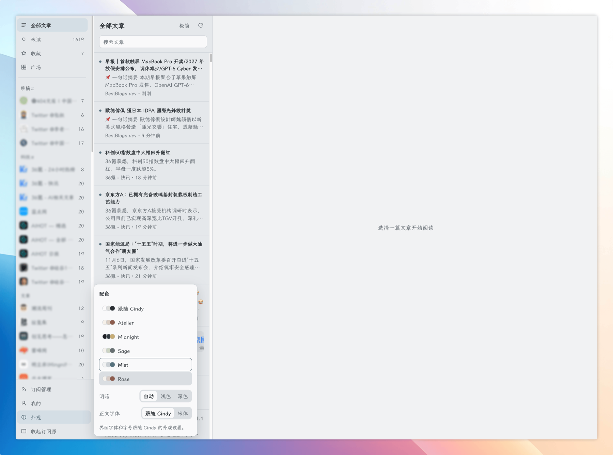

# 纵览News（zlnews）

个人自用的 RSS 阅读服务：抓取订阅、翻译、AI 改写与摘要、文章对话。
平时在 Mac 的 Cindy 插件里看，手机走懒猫快捷指令。



## 组成

| 部分 | 位置 |
|---|---|
| 服务端（本仓库） | `/Volumes/HzpSSD/Development/zlnews` |
| Cindy 插件 | `~/Documents/plugin-zhixing/cindy-plugin/zonglanRSS`（单独的仓库） |
| 访问入口 | `https://zonglan-news.jerryhuang.heiyu.space`，受懒猫认证保护 |
| 工作记录 | `~/Documents/App-ZhiXing/NookDeck/docs/zonglan-news.md` |

## 常用命令

```bash
npm test                          # 服务端测试
python3 ops/news/test_deploy.py   # 部署脚本测试
bash ops/news/launch.sh           # 本地预览，默认 4178 端口
bash ops/news/deploy.sh check     # 只读检查服务器
bash ops/news/deploy.sh deploy    # 备份 → 上传 → 构建 → 替换容器 → 健康检查
```

部署的流程、失败处理和回退见 [ops/news/README.md](ops/news/README.md)。

## 线上

- 懒猫 Linux：`/home/cosiohzp/apps/zonglan-news`，Docker Compose 服务和容器都叫 `zlnews`。
- 端口只绑 `127.0.0.1:3088`，外网访问全靠懒猫入口，不要直接暴露。
- 数据在 `data/`：数据库 `zlnews.sqlite`、缓存 `cache.json`。备份在 `zonglan-news-backups/`。
- Twitter 等路由走同一网络里的私有 RSSHub（`rsshub-x`），见 `ops/news/rsshub/`。

## 配置

写在服务器的 `.env`，部署不会覆盖它。常用几项：

| 变量 | 说明 |
|---|---|
| `DEEPSEEK_API_KEY` | 服务端默认模型的 key；插件里填了自己的 AI Key 就优先用那个 |
| `PUBLIC_ORIGIN` | 对外地址，写接口校验来源用 |
| `RSSHUB_INTERNAL_ORIGIN` | 私有 RSSHub 地址 |
| `ZLNEWS_DATA_DIR` / `ZLNEWS_DB_FILE` | 数据目录和数据库位置，默认 `./data/zlnews.sqlite` |

其他刷新间隔、自动改写条数等，看 `.env.example`。

## 改写提示词

默认用「原版风格」预设（`lib/rewrite-prompts.js`），可在插件「我的 → 资料 → 改写提示词」换成自己的。
换了之后，已有改写会显示可更新，不会自动重写。

## 记住

- 只有一个固定的个人身份，没有登录。
- 回退到 2026-11-06 改名前的镜像时，先把 `zlnews.sqlite*` 改回 `qmreader.sqlite*`，否则旧代码会新建空库。
- X 长文的标题从原文 `<h1>` 补全，见 `lib/x-article.js`。

## 来源

基于 [joeseesun/qmreader](https://github.com/joeseesun/qmreader) 修改，MIT 许可，原作者版权声明保留在 [LICENSE](LICENSE)。
